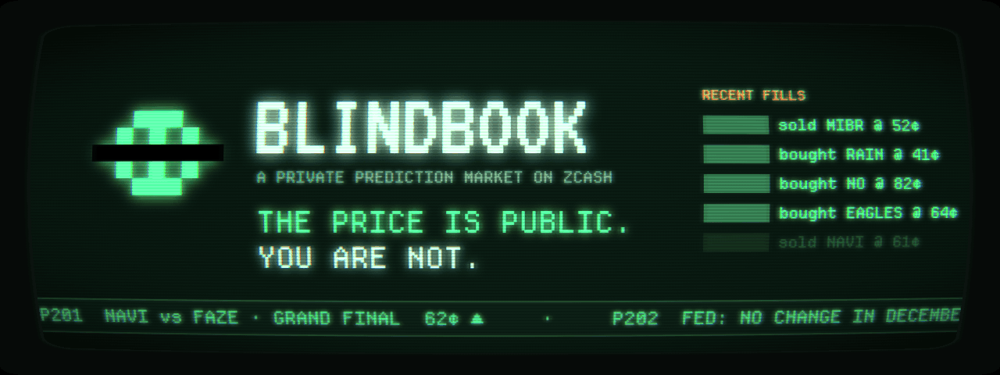
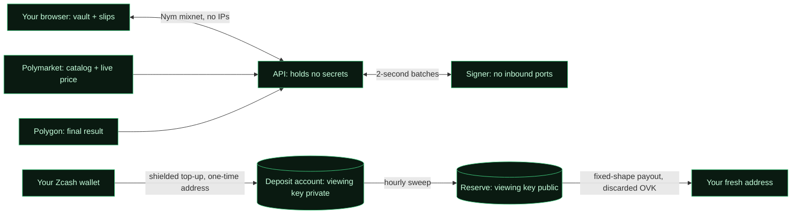
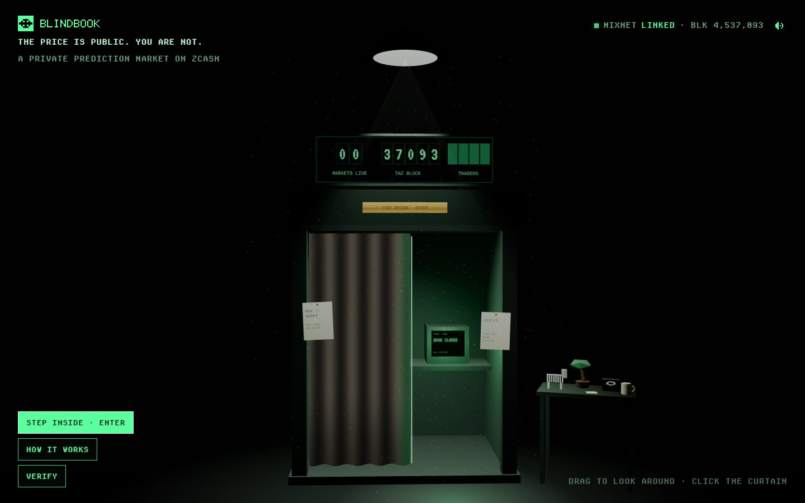
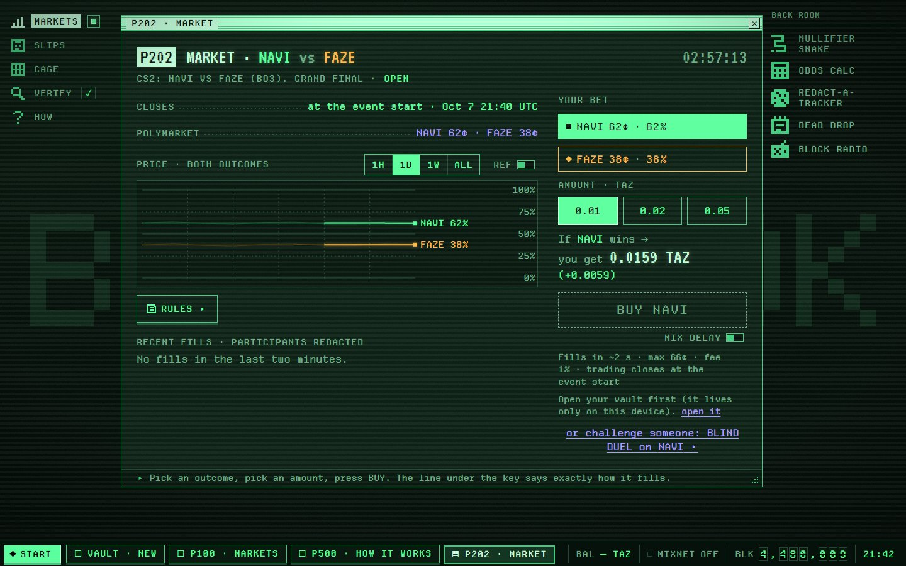
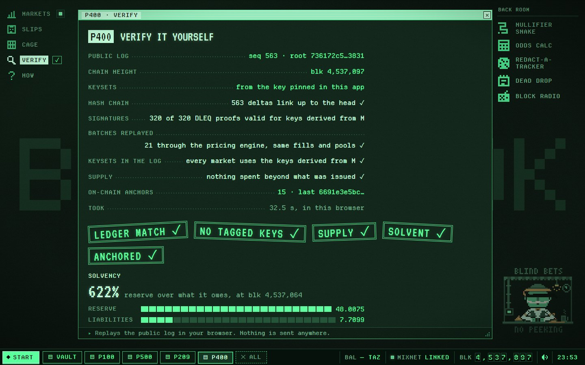
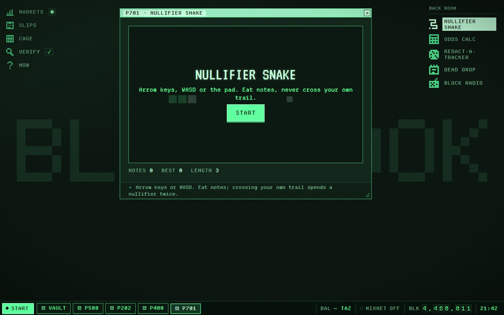
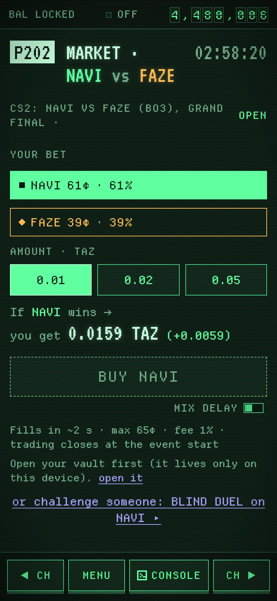
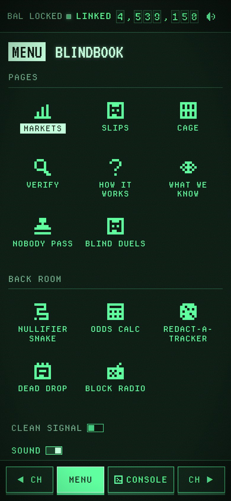

<p align="center">
  <picture>
    <source media="(prefers-reduced-motion: reduce)" srcset="docs/assets/reel/hero.png">
    
  </picture>
</p>

<p align="center">
  <b>A private prediction market on Zcash.</b><br>
  Bet on real-world events with shielded ZEC. Prices, volumes and reserves are public.<br>
  Who bet, on what, and where the winnings went is not, not even to us.
</p>

<p align="center">
  
  
  
  
</p>

<p align="center">
  <a href="#judges-the-first-minute">Judges</a> ·
  <a href="#why">Why</a> ·
  <a href="#how-it-works">How it works</a> ·
  <a href="#privacy-in-five-layers">Privacy</a> ·
  <a href="#what-you-trust-and-what-you-can-check">Trust</a> ·
  <a href="#what-you-can-do">Features</a> ·
  <a href="#check-it-yourself">Verify</a> ·
  <a href="#run-it">Run it</a> ·
  <a href="#docs">Docs</a>
</p>

---

## Judges: the first minute

No wallet needed. On a phone, every page below is under **MENU**.

1. Open **[blindbook.tech](https://blindbook.tech)** → **STEP INSIDE**. The lamp in the status bar turns **LINKED** within seconds.
2. **NEW VAULT** → **I WROTE THEM DOWN** → **later** → a passphrase, or Face ID on a phone.
3. **CAGE** → **JUDGE CODE** → paste the code from the submission → **REDEEM**. +1 TAZ (testnet ZEC) arrives.
4. **MARKETS** → any market → **BUY**. The slip prints in a few seconds.
5. On the slip, **CALLED IT?** → **COPY LINK** → open it in another browser: **VERIFIED ✓**, and nothing else about you.

Then, if you have a minute more: **VERIFY** re-checks the whole public log in your browser, and **P600** shows everything the server stored about each of your requests.

## Why

On a public prediction market, every bet is a dossier: wallet, size, timing, history. Big traders get tracked, copied and doxxed, and people who actually know something stay out.
A prediction market needs **public prices**, not **public participants**. Zcash is the one place where that split is native.

**Blindbook is the voting booth for markets:** the tally is public, the booth is private.

## How it works

1. **Top up once.** Pay a one-time shielded address from any Zcash wallet (a QR code, or one tap on a phone). Small top-ups are credited within seconds as a **private balance** that only your device knows about.
2. **Bet in seconds.** Pick a market mirrored from Polymarket (Yes/No, or named outcomes such as `NAVI vs FAZE`). Your bet clears in a **2-second batch** at one price per side: Polymarket's live price, shifted by our own users' flow.
3. **Hold bearer slips.** Positions are blind-signed e-cash. Sell them, hand them to anyone as a code or a printed slip, or cash them in when Polymarket's result is final on-chain.
4. **Withdraw** to a fresh shielded address. Nobody, including us, can tie that payout to your bets.

<p align="center">
  <picture>
    <source media="(prefers-reduced-motion: reduce)" srcset="docs/assets/reel/bet.png">
    
  </picture>
</p>



## Privacy in five layers

| Layer | Question | Closed by |
|---|---|---|
| **Funding** | Who paid? | a shielded Ironwood top-up to a one-time address nobody can recognize as ours |
| **Positions** | Who holds what? | Chaumian e-cash: blind-signed bearer slips, so even we can't link a top-up, a bet and a payout |
| **Payout** | Where did the money go? | fixed-shape shielded payouts with a discarded outgoing viewing key; the address is sealed to an isolated signer and forgotten |
| **Network** | Who is online? | every API call goes through the Nym mixnet, so no IP reaches our servers; money in and out uses a separate mixnet identity; everyone downloads the same public files; no CDN, analytics or Polymarket request from the browser. The app itself loads from a static host, which sees only that an IP opened a web app (or use the .onion mirror) |
| **Device** | What's on your phone? | an encrypted vault (Face ID on phones, a passphrase on computers), 12 words as the backup, and a restore that asks the server nothing |

| Public | Never public |
|---|---|
| prices, volumes, every batch's orders and fills (participants redacted), every slip issued and spent, the reserve, payout totals | who you are, which bets are yours, your balance, your top-up and payout addresses, your IP |

<p align="center">
  <picture>
    <source media="(prefers-reduced-motion: reduce)" srcset="docs/assets/reel/p600.png">
    
  </picture>
</p>

**The server can't see who you are, and custody is verifiable.** The internet-facing server holds no secrets. Who could learn what, and what stops each of them, is in the [threat model](docs/THREAT_MODEL.md).

## What you trust, and what you can check

Blindbook is an e-cash mint in front of a shielded reserve: the operator holds the money, and nobody, the operator included, can tell whose it is. Privacy doesn't depend on trusting the operator; the money does, within limits anyone can check.

| You trust | For | What limits it, and how you check |
|---|---|---|
| the signer, one isolated machine | keeping the reserve and signing slips | the reserve's viewing key is public: `blindbook-verify --chain` checks the real reserve covers every slip outstanding, and P400 in the browser checks the reserve reports in the log; the house's loss per market is capped by a fixed buffer the signer enforces; stakes are small (at most 2 TAZ a trade on testnet) |
| the signer to keep serving | trading, cash-in, withdrawals | it can refuse everyone, but it can't pick you out: it never learns who sends a request, and requests can't be linked to each other |
| Polymarket's result | settlement | the signer reads each result from Polymarket's contract on Polygon itself and refuses any other; `blindbook-verify --polygon` reads them again |
| the host serving the web app | loading the app | as with any web app, the host serves the code you run; it sees only that an IP opened the page (or use the .onion mirror); the code is open, and every slip the API returns is checked in your browser against keys derived from the master key the app pins |
| the Nym mixnet | hiding your IP from our servers | a public network of independent nodes; every API request goes through it (the Nym client itself talks to the network's directory and gateways to join), and the app shows the link |

You never trust us with your identity, the link between your top-up, bets and payout, or your balance: the system doesn't have them to give away. Your payout address reaches only the signer, sealed, and is forgotten once paid.

## What you can do

<p align="center">
  <picture>
    <source media="(prefers-reduced-motion: reduce)" srcset="docs/assets/reel/calledit.png">
    
  </picture>
</p>

- **Bet** on curated Polymarket markets, with both outcomes on the chart and Polymarket's rules word for word next to how Blindbook settles them.
- **Sell** before the result, or **cash in** after it. Trading closes at the event start, so nobody trades on live information faster than the reference.
- **Hand over** a position or part of your balance as a code or QR. Take back a code nobody has used yet.
- **Print** a position as a bearer paper slip with a real QR. Scanning it moves the slip into the scanner's vault and voids the paper.
- **CALLED IT.** Every trade carries a secret tag in the public log. Reveal one secret later to prove "I bought NAVI at 62¢ at block N", to whoever you choose, and nothing else.
- **Blind duels.** Challenge anyone with a link: they take the other side anonymously, and together you buy a complete set. The house carries no risk, and Polymarket's result settles it.
- **P600 · What we know about you:** the exact record the server stored for each of your requests, next to what it doesn't have.
- **NOBODY PASS:** an anonymity card with a random face, saved as an image on your device.
- **The console:** everything has a button, and the console reaches it by typing too. `verbose on` prints the cryptography as it happens.
- **The Bookie:** a blindfolded bookmaker in a stall at the edge of the desk. He stamps your bets without looking, counts credit blind, rings a bell when you called it and dozes when you're away; tap him for a tip. Sound throughout, procedural, one tap to mute.
- **The back room:** Nullifier Snake, an odds calculator, Redact-a-Tracker, Dead Drop (notes kept in your vault) and Block Radio (a chord per Zcash block). All local, nothing sent.

## Check it yourself

Everything that matters is in a hash-chained public log, anchored on-chain. Two verifiers run the same checks:

- **In the browser (P400 · VERIFY):** it downloads the log and checks
  - that the hash chain reaches the published head;
  - that every batch replays through the pricing engine (the engine's own code, built for WebAssembly) to the same fills and pools;
  - every blind signature's DLEQ proof against keys derived from the master key pinned in the app;
  - that nothing was spent beyond what was issued;
  - that the house's worst case stays within each market's buffer;
  - that the reserve report covers every liability.
- **On the command line, plus the chains:** `blindbook-verify` runs the same checks. With `--chain` it syncs a view-only wallet of the **public reserve viewing key**, checks the real reserve balance against the liabilities and opens every on-chain anchor to confirm that it names the log's root. With `--polygon` it reads every market's result again from Polymarket's contract on Polygon.

```bash
cargo run --release -p blindbook-verify -- <M> https://<api> --chain zecrocks --polygon public
```

Nobody has to trust the internet-facing server with results either: the signer reads each result from Polygon itself and refuses any other.

## Design

**The Blind Booth.** You step into a booth, the curtain closes, and a green-phosphor terminal from an alternate 1986 boots up: teletext pages, split-flap digits, a scope for prices, a retro desktop with a taskbar, thermal receipts and paper slips. Wherever an exchange would show a person, there's a black redaction bar. On a phone it becomes a handheld pager.

<p align="center">
  
  <br>
  
  <br>
  
  
</p>

## Run it

A local copy on your own computer, no Zcash node needed: a development server with the real API and the signer in one process, three synthetic markets, a block every 15 seconds and a local judge code, `DEV-JUDGE`. You need Rust 1.95 with the `wasm32-unknown-unknown` target (the app's verifier runs the engine as WebAssembly), Node 22 and pnpm 10.

```bash
cargo run -p blindbook-api --features embedded-signer --example devserver
```

```bash
pnpm --dir web install && pnpm --dir web dev
```

Open http://127.0.0.1:5173 (your local copy, not the live site), make a vault, redeem `DEV-JUDGE` in F3 CAGE → JUDGE CODE, and bet. Tests:

```bash
cargo test --workspace && cargo test -p blindbook-api --features embedded-signer
```

The development build talks to the server directly. The production build (`VITE_BB_MIXNET=1`) sends every API request through the Nym mixnet.

## Docs

| | |
|---|---|
| [ARCHITECTURE](docs/ARCHITECTURE.md) | the five layers, components and keys, every flow, pricing, settlement, verification, timing, deployment |
| [PROTOCOL](docs/PROTOCOL.md) | units, keysets, slips, the API, the anchored LMSR with the exposure invariant, CALLED IT, duels, the public log, the signer, chain transactions |
| [MARKETS](docs/MARKETS.md) | what we take from Polymarket, named outcomes, listing rules, the rules panel, halts, on-chain settlement |
| [THREAT_MODEL](docs/THREAT_MODEL.md) | adversaries, who can learn what, and what stops each of them |
| [DESIGN](docs/DESIGN.md) | the Blind Booth: clarity rules, usability targets, hard privacy constraints |
| [DEPLOY](deploy/README.md) | two servers and a static host: keys, Compose, Caddy, Tor, the app builds, checks |
| [SECURITY](SECURITY.md) | how to report a leak |

## Repository layout

```
crates/
  blindbook-engine/       anchored LMSR, 2-second batches, exposure invariant (pure, deterministic)
  blindbook-engine-wasm/  the engine for WebAssembly: the browser verifier's replay, the determinism check
  blindbook-ledger/       batches around the engine, slips issued and spent, duels, the hash-chained log, replay
  blindbook-mint/         keysets derived from the pinned master key, blind signatures with DLEQ proofs
  blindbook-polymarket/   catalog, live order books, anchor and guard, feed health; the Polygon resolver
  blindbook-indexer/      one-time top-up addresses, payment detection with the incoming viewing key
  blindbook-api/          the secretless server: sequencer, listing rules, top-up desk, public log, live feed, price history
  blindbook-signer/       holds every key; checks and signs; its own indexer, log, Polygon reads, treasury loop
  blindbook-treasury/     deposit and reserve wallets: sweeps, 8-action payouts, anchors; the reserve watch
  blindbook-seal/         sealed withdrawal addresses (X25519 + HKDF + AES-GCM) and their commitments
  blindbook-verify/       the independent auditor (the same replay runs in the browser)
web/                      the app: vault, slip wallet, mixnet client, terminal UI, pager, 3D booth
docs/                     everything above
deploy/                   Docker image, Compose files, Caddy and Tor configuration, app build script
```

## Built with

[Zcash](https://z.cash) Ironwood and [librustzcash](https://github.com/zcash/librustzcash) · [Nym](https://nym.com) mixnet (mix-fetch) · [Cashu](https://cashubtc.github.io/nuts/) blind-signature primitives · [Polymarket](https://polymarket.com) public market data · Polygon (Polymarket's ConditionalTokens) for settlement · Rust, React, three.js.

Every dependency is MIT or Apache-2.0 licensed; the fonts are under the SIL Open Font License.

Blindbook is an independent project. It is not affiliated with Polymarket, Zcash or Nym.

## License

[MIT](LICENSE). The bundled fonts keep their own licenses, the SIL Open Font License 1.1 (IBM Plex Mono, VT323, Departure Mono; the license files sit next to the fonts in `web/src/design/fonts/`); libraries keep theirs.
