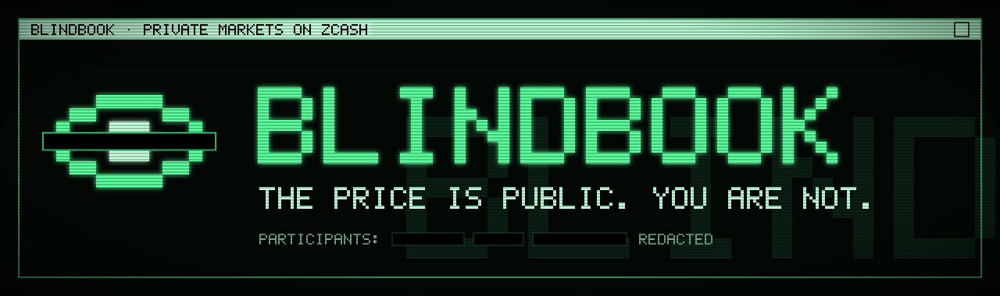
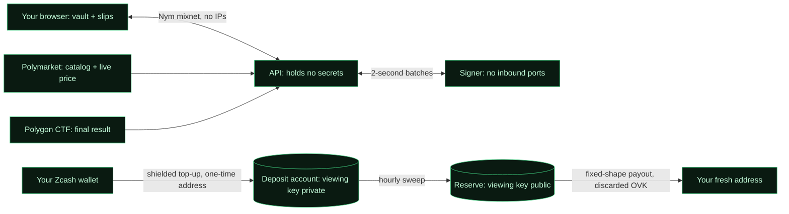

<p align="center">
  
</p>

<p align="center">
  <b>A private prediction market on Zcash.</b><br>
  Bet on real-world events with shielded ZEC. Prices, volumes and reserves are public.<br>
  Who bet, on what, and where the winnings went is not, not even to us.
</p>

<p align="center">
  
  
  
  
  
</p>

<p align="center">
  <a href="#why">Why</a> ·
  <a href="#how-it-works">How it works</a> ·
  <a href="#privacy-in-five-layers">Privacy</a> ·
  <a href="#called-it">Called it</a> ·
  <a href="#design">Design</a> ·
  <a href="#docs">Docs</a> ·
  <a href="#status">Status</a>
</p>

---

## Why

On a public prediction market, every bet is a dossier: wallet, size, timing, history. Big traders get tracked, copied and doxxed, and people who actually know something stay out.
A prediction market needs **public prices**, not **public participants**. Zcash is the one place where that split is native.

**Blindbook is the voting booth for markets:** the tally is public, the booth is private.

## How it works

1. **Top up once.** Pay a one-time shielded address from any Zcash wallet (one tap on iPhone via Zodl, or a QR code). Small top-ups are credited in seconds as a **private balance** that only your device knows about.
2. **Bet in seconds.** Pick a market mirrored from Polymarket (Yes/No or named outcomes such as `LEGACY vs PARIVISION`). Your bet clears in a **2-second sealed batch** at one price per side: Polymarket's live price, shifted by our users' own flow.
3. **Hold bearer slips.** Positions are blind-signed e-cash. Sell them, hand them to anyone as a QR code, or redeem when Polymarket's result is final on-chain.
4. **Withdraw** to a fresh shielded address. Nobody, including us, can tie that payout to your bets.



## Privacy in five layers

| Layer | Question | Closed by |
|---|---|---|
| **Funding** | Who paid? | Ironwood shielded top-up to a one-time address nobody can recognize as ours |
| **Positions** | Who holds what? | Chaumian e-cash: blind-signed bearer slips, so even we can't link a top-up, a bet and a payout |
| **Payout** | Where did the money go? | fixed-shape shielded batches with a discarded outgoing viewing key; destinations sealed to an isolated signer |
| **Network** | Who is online? | every request through the Nym mixnet, so no IP ever reaches us; money in and out on a separate mixnet identity; one identical data bundle for everyone; no CDN, analytics or Polymarket calls from the browser (only the mixnet's own directory and entry gateway see that an IP uses Nym) |
| **Device** | What's on your phone? | encrypted vault opened with Face ID on phones (a passphrase on computers), a 12-word phrase as backup, restore without asking the server anything |

| Public | Never public |
|---|---|
| prices, volumes, every batch's fills (with participants redacted), issuance, reserves, payout totals | who you are, which bets are yours, your balance, your deposit and payout addresses, your IP |

**Privacy is trustless. Custody is verifiable.** The internet-facing server holds no secrets. Your browser can replay the whole public log and check prices, issuance and solvency against the public reserve. Every known leak and its fix is in the [threat model](docs/THREAT_MODEL.md).

## Called it

> **Anonymous by default. Provable by choice.**

Every trade carries a secret tag in the public log, which is anchored on-chain. Months later you can reveal that one secret to prove *"I bought LEGACY at 18¢ at block 3,514,220"*: to a friend, a follower or a journalist, whenever and to whoever you choose. Their browser checks it against the anchored log and stamps **VERIFIED ✓**. Nothing about your other trades, balance or payouts is revealed. It's Zcash's selective disclosure, applied to forecasting: reputation without identity.

## Design

**The Blind Booth.** You step into a booth, the curtain closes, and a green-phosphor CRT terminal from an alternate 1986 boots up: teletext pages, split-flap digits, an oscilloscope for prices, a retro desktop with pixel shortcuts and a taskbar, thermal receipts and paper betting slips. Wherever an exchange would show a person, there's a black redaction bar. On a phone it becomes a handheld pager. On the desktop sit the **back-room** apps, local-only toys: Nullifier Snake (touch your own tail and it's a double-spend), an odds calculator, Redact-a-Tracker and Block Radio, which turns every new Zcash block into a chord.

<p align="center">
  
  &nbsp;
  <br>
</p>

## Docs

| Product | |
|---|---|
| [ARCHITECTURE](docs/ARCHITECTURE.md) | the five layers, components, keys, flows, "called it", timing budget, deployment |
| [PROTOCOL](docs/PROTOCOL.md) | units, keysets, slips, API, anchored LMSR with the exposure invariant (worked examples), proofs, signer |
| [MARKETS](docs/MARKETS.md) | what we take from Polymarket, named outcomes, rules and trade conditions, halts, on-chain settlement |
| [THREAT_MODEL](docs/THREAT_MODEL.md) | adversaries, who-can-learn-what matrix, every leak and its fix, residual risks |
| [DESIGN_BRIEF](docs/DESIGN_BRIEF.md) | the Blind Booth: identity, clarity and restraint rules, screens, console, easter eggs |

| Project | |
|---|---|
| [ROADMAP](docs/ROADMAP.md) | day-by-day plan, gates and fallbacks, cut list, budget, risk register |
| [SUBMISSION](docs/SUBMISSION.md) | Zecathon rules check, description, judge quickstart, video storyboard |
| [RESEARCH](docs/RESEARCH.md) | Zcash after Ironwood, Polymarket, NEAR Intents, Nym, Cashu, prior art, external review |

## Status

Design is complete and the risky parts are proven on testnet (Gate 1, Oct 6); the build has started. Development runs on a local Regtest chain, the judge playground runs on **testnet**, and a **mainnet** proof runs the same build with micro stakes.

- [x] Research, architecture, protocol, threat model, design brief
- [x] Spikes ([`spikes/`](spikes/)): Nym mixnet in the browser · one-time deposit addresses on testnet · blind signatures Rust ↔ browser · Polymarket + Polygon · engine · fixed-shape payouts
- [x] Engine (native = WASM), mint keysets and blind signatures, Polymarket mirror and Polygon resolver
- [x] Ledger: batches around the engine, spent set, issuance, swaps, redemptions, withdrawals, hash-chained log
- [x] Signer core: checks every slip and claim, applies the same ledger operation, signs with DLEQ
- [x] API service (sequencer, journal, public log files, live prices) and the signer link with exact-once recovery
- [x] Indexer: one-time addresses, mempool SEEN and block detection with the incoming viewing key; top-ups credited on testnet in under 2 s
- [ ] Payouts, sweeps, anchors, verifier
- [ ] Web app (vault, slips, markets, cage, called it, verify)
- [ ] Testnet playground and mainnet proof
- [ ] Demo video

### Repository layout

```
crates/
  blindbook-engine/   anchored LMSR, 2-second batches, exposure invariant (pure, deterministic, also WASM)
  blindbook-engine-wasm/  the engine as a wasm32 module (the browser verifier, the determinism check)
  blindbook-ledger/   batches around the engine, spent set, issuance, the hash-chained public log (pure)
  blindbook-indexer/  one-time top-up addresses, payment detection with the incoming viewing key, chain follower
  blindbook-mint/     keysets derived from the pinned master key, blind signatures with DLEQ proofs
  blindbook-polymarket/  Polymarket mirror: catalog, live books, anchor, guard, feed health; Polygon resolver
  blindbook-api/      secretless: top-up desk, trade batches, bundle and live feed (axum)
  blindbook-signer/   holds all keys; replays before signing; blind signatures, sweeps, payouts, anchors
  blindbook-verify/   independent auditor (CLI; the same engine runs in the browser)
web/                  static app: vault, slip wallet, mixnet client, terminal UI, 3D booth, console
video/                demo video (Remotion)
deploy/               docker compose, Caddy, Tor onion service
docs/                 everything above
design/               design exports and references
```

The code folders appear as the build progresses.

## Built with

[Zcash](https://z.cash) Ironwood and [librustzcash](https://github.com/zcash/librustzcash) · [Nym](https://nym.com) mixnet (mix-fetch) · [Cashu](https://cashubtc.github.io/nuts/) blind-signature primitives · [Polymarket](https://polymarket.com) public market data · Polygon (Polymarket's ConditionalTokens) for settlement · Rust, React, three.js.

Blindbook is an independent project. It is not affiliated with Polymarket, Zcash or Nym.

## Security

Found a leak or a way to break the claim? See [SECURITY.md](SECURITY.md).

## License

[MIT](LICENSE)
